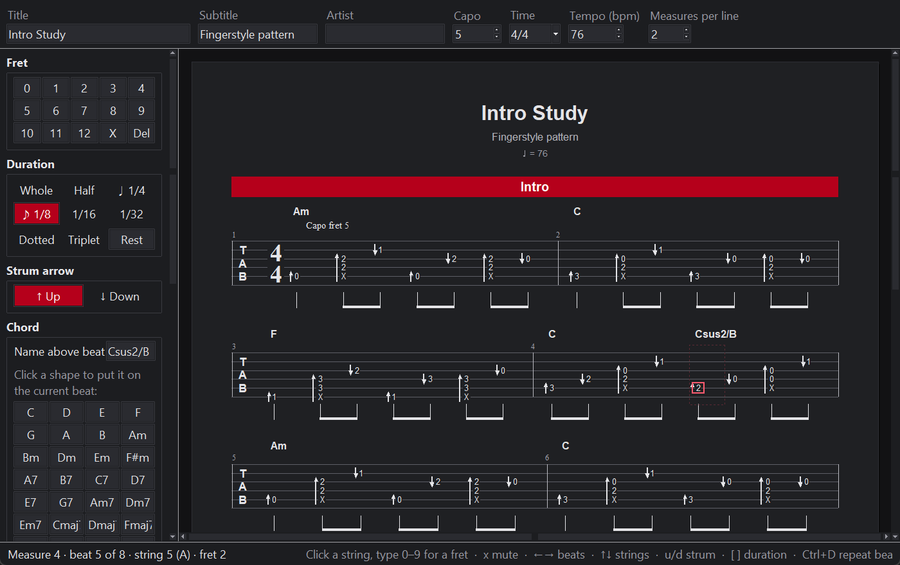

# Tab Writer

A desktop editor for guitar tabs. Click on the staff, type fret numbers, pick durations and strum arrows,
drag notes around — and print a clean sheet with chord names, capo note, time signatures, rhythm beams
and red section bars. Pure Python (tkinter), no dependencies.



## Start

```sh
python tab_writer.py                    # empty song
python tab_writer.py examples/intro.tab # open a file
python -m tabwriter examples/intro.tab  # same thing
```

## Editing

| Do | How |
| --- | --- |
| Place the cursor | Click a string at a beat |
| Enter a fret | Type `0`–`9` (two digits quickly for 10–24), or use the Fret buttons; `x` = muted |
| Move around | `←` `→` / Space for beats, `↑` `↓` for strings, `Ctrl+←/→` for measures |
| Move a note | Drag it to another string or beat (`Ctrl`+drag copies), or `Alt+↑/↓` |
| Reorder beats | `Alt+←/→` |
| Duration | Duration buttons, or `[` longer / `]` shorter, `.` dotted, `t` triplet — shortening fills the gap with a rest, lengthening uses up following rests |
| Strum arrow | `u` up, `d` down (press again to remove) |
| Chord | Click a shape (G, Am, …) to fill the beat; `c` or double-click above the staff to type a chord name |
| Repeat a beat | `Ctrl+D` copies the beat onto the next one — quick for strumming patterns |
| Rest / delete | `r` makes a rest; `Delete` removes the note, or the beat if it's empty |
| Measures | `Enter` adds one; Measure panel: duplicate, copy/paste (`Ctrl+C/V`), delete, time signature from here, new line after |
| Select measures | Drag across the sheet from an empty spot, `Shift`+click to extend, `Ctrl+A` for all; then `Delete`, right-click (delete / copy / duplicate / clear), or the Measure panel buttons. `Esc` clears |
| Grid | Measure panel: 1/1, 1/2, 1/4 or 1/8 (default) — the empty slots new measures start with; also re-divides the rests of the current measure |
| Sections | Section panel: rename, start a new section at the cursor, add one at the end; click a red bar to select it |
| Song | Title, subtitle, artist, capo, time, tempo and measures per line (default 2, 0 = as many as fit) in the top bar |
| Undo | `Ctrl+Z` / `Ctrl+Y` |
| Dark mode | **View → Dark mode** (on by default, remembered). Printing is always black on white |

New measures are filled with rests on the grid (eighths by default), so you can click each slot and type. Measures whose
length doesn't match the time signature get a red measure number and appear under **Problems**.
Press `F1` for all shortcuts.

## Import from YouTube

**File → Import from YouTube…** (`Ctrl+I`) turns a song into an editable tab draft using the separate
[guitar-transcriber](#guitar-transcriber) project: it separates the guitar from the recording, finds the
chords, fret shapes, capo and every pick stroke, and Tab Writer lays that out as bars with chord names,
strum arrows and rhythm.

- Search by name or paste a YouTube link. Songs analysed before open instantly; new ones take a few
  minutes on the GPU (progress is shown, and you can stop it).
- Options: use capo shapes when a capo is detected, strum arrows (down on the beat, up in between — a guess),
  and rhythm rounded to eighths (easier to read) or kept at sixteenths.
- The result is a draft: check it by ear and fix it with the normal editing tools.
- **Play along**: imported tabs get a transport bar above the sheet. Play (`Ctrl+Space`) starts at the cursor
  and a playhead follows the music through the tab; click anywhere to jump there, pause to leave the cursor
  on the current beat. Choose the full song or the separated guitar track. Each bar's position in the audio
  is saved in the file (`~12.34` at the start of a measure), so this still works after saving, reopening and
  editing. Windows only, and it needs guitar-transcriber's song folder to still be there.

From the command line: `python -m tabwriter import --list`, then `python -m tabwriter import <video id> -o song.tab`.

### guitar-transcriber

Not included here: it needs PyTorch, demucs and a GPU, so it lives in its own folder with its own `.venv`.
Tab Writer looks for it in `D:\guitar-transcriber`, the `TABWRITER_TRANSCRIBER` environment variable, or a
folder you pick in the import dialog. Tab Writer itself still has no dependencies.

## Printing

- **File → Print** (`Ctrl+P`) opens the sheet in your browser's print dialog (A4 by default).
- **File → Export PDF** uses an installed Chrome, Edge or Chromium (`TABWRITER_BROWSER` overrides the path).
- **File → Export HTML** writes a standalone page.

Without opening the window: `python -m tabwriter build song.tab --pdf` (or `-o song.html`).

## The .tab file format

Files are plain text, so they're easy to diff or tweak. **View → Text source** shows the text next to the
sheet and applies edits as you type.

```text
title: Intro Study
capo: 5
time: 4/4
tempo: 76

# Intro
| [Am] 0.5^ :8 (2.3 2.4 x.5)^ 1.2v 0.5^ 2.3v (2.3 2.4 x.5)^ 0.3v | % |
| @3/4 :4 [G] 320003v 320003v 320003^ |
```

| Write | Means |
| --- | --- |
| `title:` `subtitle:` `artist:` `capo:` `time:` `tempo:` | Song settings |
| `tuning: D A D G A D` | Low to high; the count sets the number of strings |
| `page: letter` | Paper size, `A4` by default |
| `per_line: 2` / `grid: 8` | Measures per line of tab (0 = fit by width) / slot size for new measures |
| `# Chorus` | Section |
| `\| … \|` | Measures; each line of text is one line of tab |
| `3.5` / `x.6` | Fret 3 on string 5 (string 1 = high e) / muted string |
| `(2.3 2.4 x.5)` or `x02210` | Notes played together; shapes list strings from low E to high e |
| `^` `v` suffix | Up / down strum arrow |
| `:4` `:8` `:16` `:4.` `:8t` | Duration of following notes (dotted, triplet) |
| `r` `[Am]` `%` `@3/4` | Rest, chord name, repeat previous measure, time change |
| `~12.34` | This measure starts 12.34 s into the recording (written by the YouTube import) |
| `def x = …` / `$x` | Reusable snippet (expanded once you edit visually) |

## Code

- `tabwriter/gui.py` – the tkinter editor
- `tabwriter/editing.py` – editing operations, cursor, undo (no GUI; unit-tested)
- `tabwriter/layout.py` – page geometry shared by the screen and the printout
- `tabwriter/render.py` – HTML/SVG for printing · `export.py` – PDF
- `tabwriter/parser.py` / `serialize.py` – .tab text ⇄ model (`model.py`)
- `tabwriter/transcriber.py` / `import_dialog.py` – YouTube import via guitar-transcriber

Tests: `python -m unittest discover -s tests -t .`
